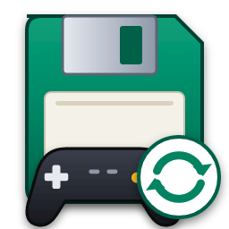
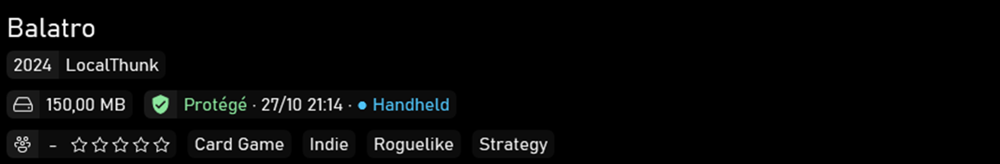
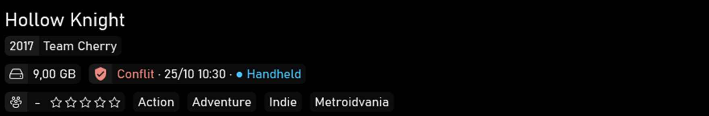

# AutoGameSoftwareSync pour Playnite

[English](README.md)

Extension [Playnite](https://playnite.link) gratuite : elle affiche, pour chaque jeu, ce que [AutoGameSoftwareSync](https://github.com/Epikou/AutoGameSoftwareSync) (AGSS) sait de ses sauvegardes :

- l'état : **Protégé**, **À envoyer**, **Conflit**, **Cloud plus récent**...
- la date de la dernière synchronisation ;
- l'appareil d'où vient la version en place, dans sa couleur.

AGSS fait tout le travail. L'extension ne lance, ne restaure et ne sauvegarde rien, et n'écrit jamais dans tes sauvegardes ni dans ton coffre.

Nouveau en 1.2.0 : elle transmet aussi à AGSS la liste de tes **jeux installés**, pour qu'AutoGameSoftwareSync 2.0.3 ou plus récent te propose ceux que tu ne protèges pas encore (y compris les jeux ajoutés à la main).

**Ce qu'elle lit et écrit, en clair** : elle lit le `status.json` d'AGSS et la bibliothèque Playnite (jeux installés) ; elle écrit `playnite-library.json` dans le dossier de données AGSS ; en mode repli seulement, elle ajoute ou retire un genre (ou étiquette / fonctionnalité / catégorie) sur les jeux suivis par AGSS. Rien d'autre, jamais : aucun de tes fichiers n'est copié, déplacé ni supprimé.

## Thèmes plein écran reconnus

Pour ces thèmes, une pastille est insérée dans la fiche du jeu, dans le style du thème. Rien à régler.

| Thème | Version vérifiée |
|---|---|
| Solaris | 1.3.6 |
| ReskinPS5 | 1.11 |
| (u)biquity | 2.0.4 |
| PS5ish | 5.0.3 |
| PlayniteModernUI | 1.6.2 |
| Playnite Deck | 3.0.2 |
| Nintendo Switch-ish | 2.0.0 |
| Toggle | 1.10.1 |

Captures : voir le [README anglais](README.md#supported-fullscreen-themes).

### Les autres thèmes : le genre de repli

Si le thème plein écran actif n'est pas dans la liste (par exemple XBOXSERIESish, dont la carte de détails à taille fixe ne peut pas recevoir une ligne de plus), l'extension ajoute un genre du type `● AGSS : Protégé · MONPC`. Le `●` le place en tête de liste. Il est remplacé quand l'état change, retiré quand il ne sert plus et remis après un téléchargement de métadonnées. Aucun genre n'est écrit tant qu'une pastille fonctionne. Seuls les éléments à la forme exacte de l'extension (préfixe suivi d'un état) sont retirés : un genre à toi n'est jamais touché. Choisis *Pastille seulement* dans les réglages pour que rien ne soit jamais ajouté à tes jeux ; le menu *AGSS : remove all added items* enlève tout.

Les auteurs de thèmes peuvent placer l'information eux-mêmes : voir [docs/THEMES.md](docs/THEMES.md) (en anglais).

## Liste des jeux installés (1.2.0)

L'extension écrit `playnite-library.json` à côté du `status.json` d'AGSS, dans le dossier de données AGSS (`%LOCALAPPDATA%\AutoGameSoftwareSync`, ou le dossier désigné par `AUTOGAMESOFTWARESYNC_DATA_DIR`, ou le chemin de `status.json` saisi dans les réglages). Elle l'écrit d'un coup, seulement quand la liste change, et seulement à côté d'un `status.json` existant : l'extension ne crée jamais le dossier d'AGSS. Le fichier est supprimé si tu décoches *Write the installed games list for AGSS* ou si tu désactives l'extension.

Une entrée par jeu installé : identifiant Playnite, nom, source (Steam, GOG...), extension de bibliothèque, dossier d'installation, programmes, identifiant dans sa bibliothèque, identifiant Steam, plateformes, jeu masqué ou non, et pour les jeux émulés les ROM et l'émulateur. Ni temps de jeu, ni score, ni compte. Les chemins d'installation contiennent naturellement ton nom d'utilisateur Windows ; le fichier reste sur ce PC et l'extension n'envoie rien nulle part. Format et exemple : [docs/PLAYNITE-LIBRARY.md](docs/PLAYNITE-LIBRARY.md) (en anglais). AutoGameSoftwareSync 2.0.3 ne se sert pas encore des jeux émulés.

## Prérequis

- Playnite 10 (API d'extensions 6.15 ou plus récente).
- AutoGameSoftwareSync **2.0 ou plus récent**. Le meilleur affichage demande la **2.0.2 ou plus récente** (la version qui fournit le nom et la couleur de l'appareil dans `status.json`) ; avec la 2.0.0, l'état et la date s'affichent mais pas l'appareil. La liste des jeux installés demande **AutoGameSoftwareSync 2.0.3 ou plus récent**.

## Installation

1. Télécharge `AutoGameSoftwareSync_Playnite_Plugin_1_2_0.pext` depuis la [dernière version](https://github.com/Epikou/AutoGameSoftwareSync-Playnite/releases/latest).
2. Double-clique dessus (ou glisse-le dans Playnite) et confirme l'installation. Redémarre Playnite si demandé.
3. C'est tout : le dossier de données AGSS, le thème actif et la langue sont détectés automatiquement, et l'affichage suit `status.json` en direct.

Les réglages restent disponibles dans Playnite (Extensions > Paramètres des extensions) : mode d'affichage, champ, préfixe, liste des jeux installés, chemin de `status.json`, notifications facultatives sur Conflit / Cloud plus récent (désactivées par défaut).

Les textes d'état suivent la langue de Playnite (anglais, français, russe, espagnol, chinois) ; les réglages, le menu et les messages sont en anglais.

Désinstaller laisse `playnite-library.json` et les genres de repli en place (Playnite n'a pas de crochet de désinstallation) : décoche d'abord *Write the installed games list* et lance *AGSS : remove all added items* pour une sortie propre.

## À propos

Projet « vibecodé » : l'extension a été testée à la main dans Playnite 10 avec les thèmes ci-dessus, et accompagnée d'une suite de tests automatiques. Elle est gratuite ; si elle te sert, tu peux soutenir le projet sur [Ko-fi](https://ko-fi.com/autogamesoftwaresave).

Questions, aide et nouveautés : rejoins le [Discord](https://discord.gg/W8YXUJAK4e).

Le code source est visible dans ce dépôt (`src`, `tests`) pour que tu puisses lire et auditer ce que fait l'extension. Ce n'est pas un logiciel libre : voir [LICENSE](LICENSE). Pour compiler et tester : `dotnet build` / `dotnet test` (.NET Framework 4.6.2, PlayniteSDK 6.15.0).

## Licence

Gratuit pour un usage personnel, code visible mais tous droits réservés : voir [LICENSE](LICENSE). Playnite et PlayniteSDK appartiennent à leurs auteurs respectifs.
