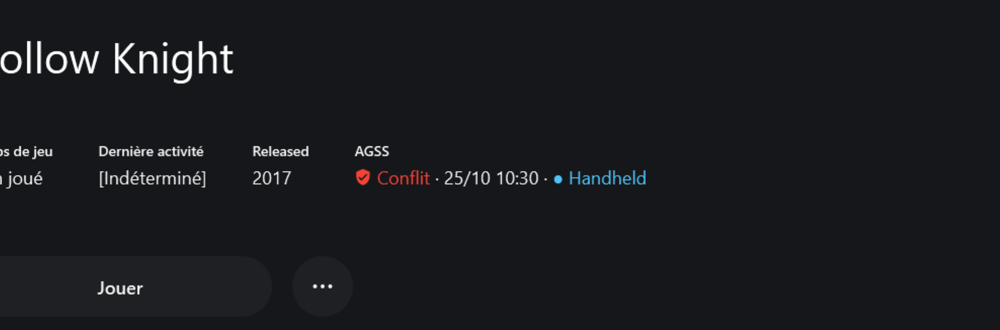
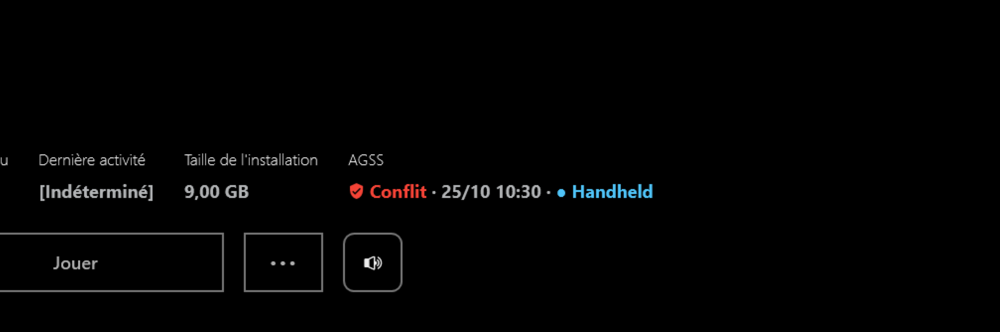
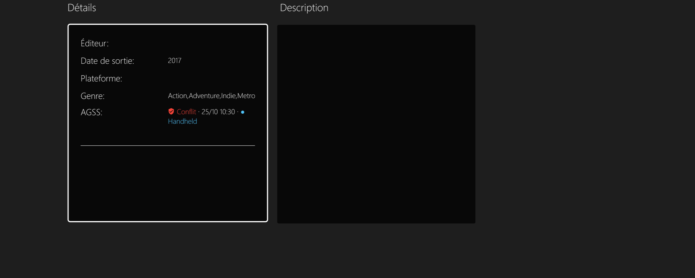
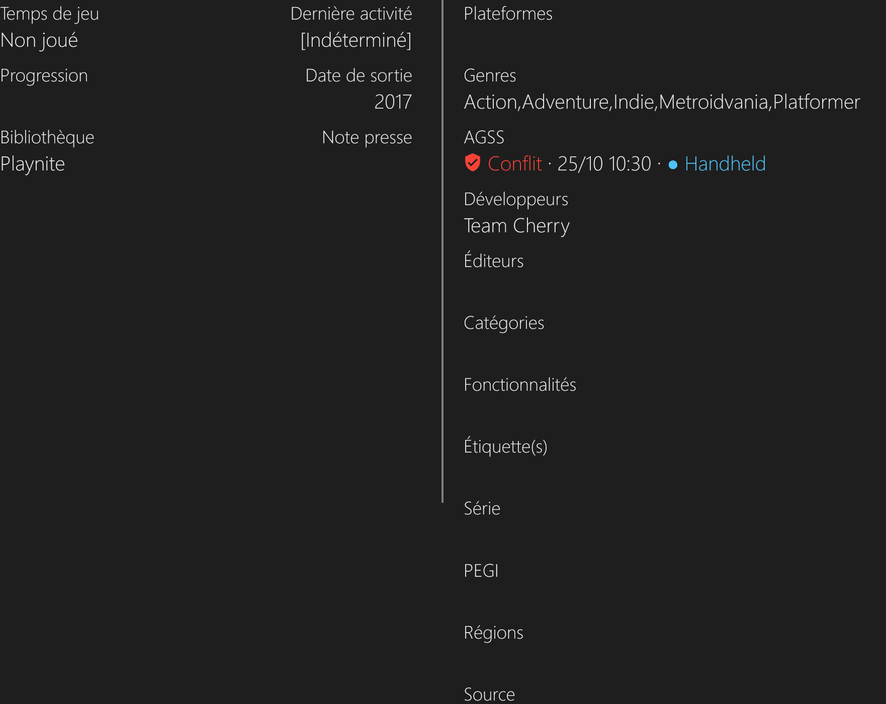
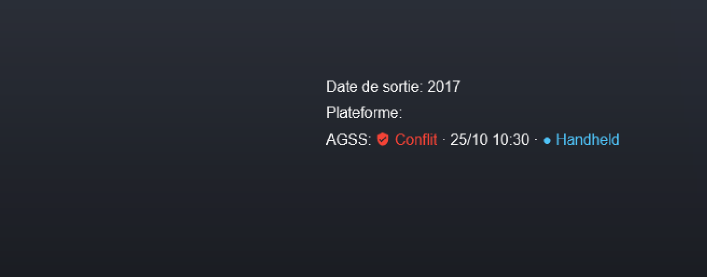
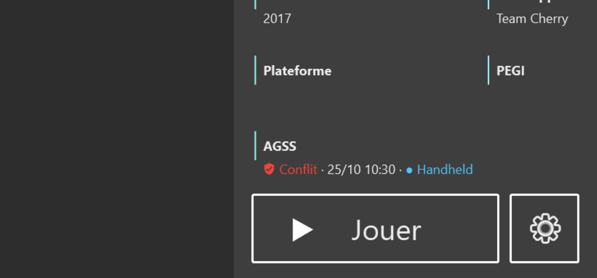
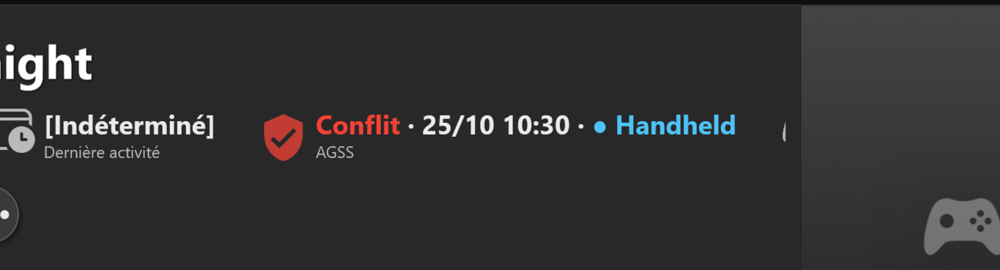

# AutoGameSoftwareSync for Playnite

[Francais](README.fr.md)

A free, **read-only** [Playnite](https://playnite.link) extension that shows, for each game, what [AutoGameSoftwareSync](https://github.com/Epikou/AutoGameSoftwareSync) (AGSS) knows about its saves:

- the state: **Protected**, **To upload**, **Conflict**, **Cloud newer**...
- the date of the last sync;
- the device the version in place comes from, in its own colour.

AGSS does all the work. This extension only reads the `status.json` file that AGSS writes. It never launches, restores or backs up anything, and it never writes to your save files or to your vault.

## Supported fullscreen themes

For these themes a badge is inserted into the game page, in the theme's own style. Nothing to configure.

| Theme | Checked version |
|---|---|
| Solaris | 1.3.6 |
| ReskinPS5 | 1.11 |
| (u)biquity | 2.0.4 |
| PS5ish | 5.0.3 |
| PlayniteModernUI | 1.6.2 |
| Playnite Deck | 3.0.2 |
| Nintendo Switch-ish | 2.0.0 |
| Toggle | 1.10.1 |

| | |
|---|---|
|  |  |
|  |  |
|  |  |
|  | |

### Any other theme: the genre fallback

If the active fullscreen theme is not in the list (for example XBOXSERIESish, whose fixed-size details card cannot take an extra line), the extension adds a genre such as `● AGSS : Protected · MYPC`. The `●` makes it sort first. It is replaced when the state changes, removed when it is no longer needed and restored after a metadata download. No genre is written while a badge works.

Theme authors can place the information themselves: see [docs/THEMES.md](docs/THEMES.md).

## Requirements

- Playnite 10 (extension API 6.15 or newer).
- AutoGameSoftwareSync **2.0 or newer**. The best display needs **2.0.2 or newer** (the version that ships the device name and colour in `status.json`); with 2.0.0 the state and date are shown but not the device.

## Installation

1. Download `AutoGameSoftwareSync_Playnite_Plugin_1_1_0.pext` from the [latest release](https://github.com/Epikou/AutoGameSoftwareSync-Playnite/releases/latest).
2. Double-click it (or drag it onto Playnite) and confirm the installation. Restart Playnite when asked.
3. That's all: the AGSS data folder, the active theme and the language are detected automatically, and the display follows `status.json` live.

Settings stay available in Playnite (Add-ons > Extensions settings): display mode, field, prefix, `status.json` path, optional notifications on Conflict / Cloud newer (off by default).

Texts follow Playnite's language: English, French, Russian, Spanish and Chinese.

## About

Made with vibe coding: the extension was written with an AI assistant, tested by hand in Playnite 10 with the themes above, and comes with an automated test suite. It is free; if it is useful to you, you can support the project on [Ko-fi](https://ko-fi.com/autogamesoftwaresave).

The source code is visible in this repository (`src`, `tests`) so that you can read and audit what the extension does. It is not open source: see [LICENSE](LICENSE). To build and test it: `dotnet build` / `dotnet test` (.NET Framework 4.6.2, PlayniteSDK 6.15.0).

## License

Free for personal use, source visible but all rights reserved: see [LICENSE](LICENSE). Playnite and PlayniteSDK belong to their respective authors.
